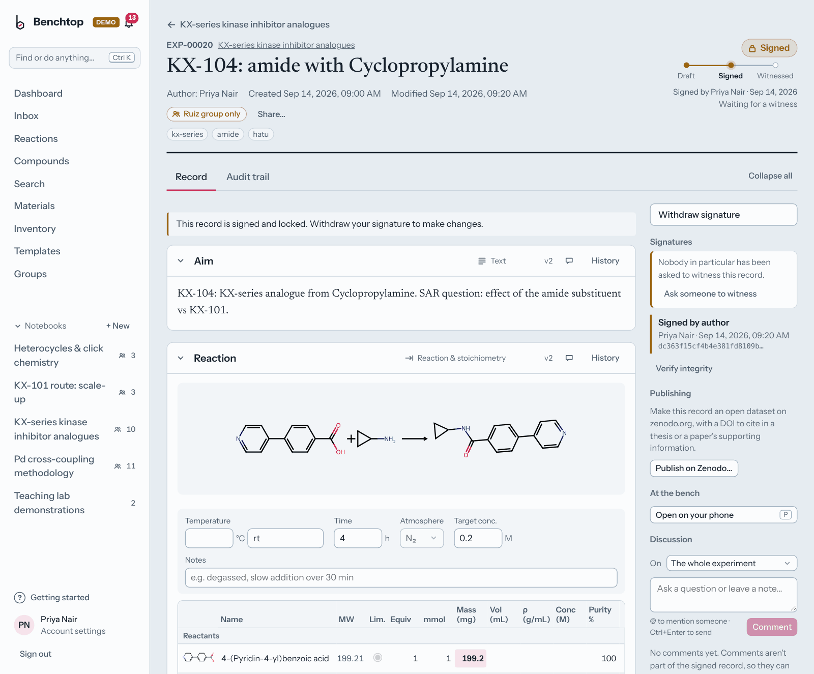
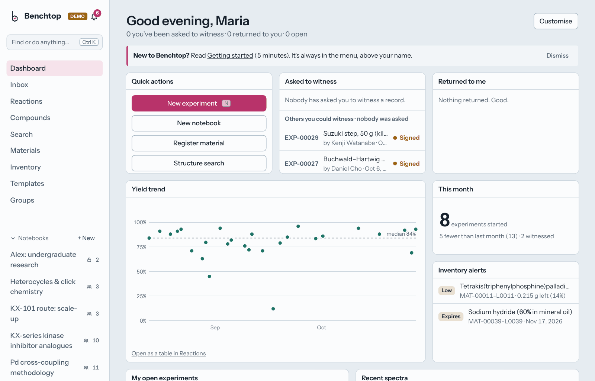
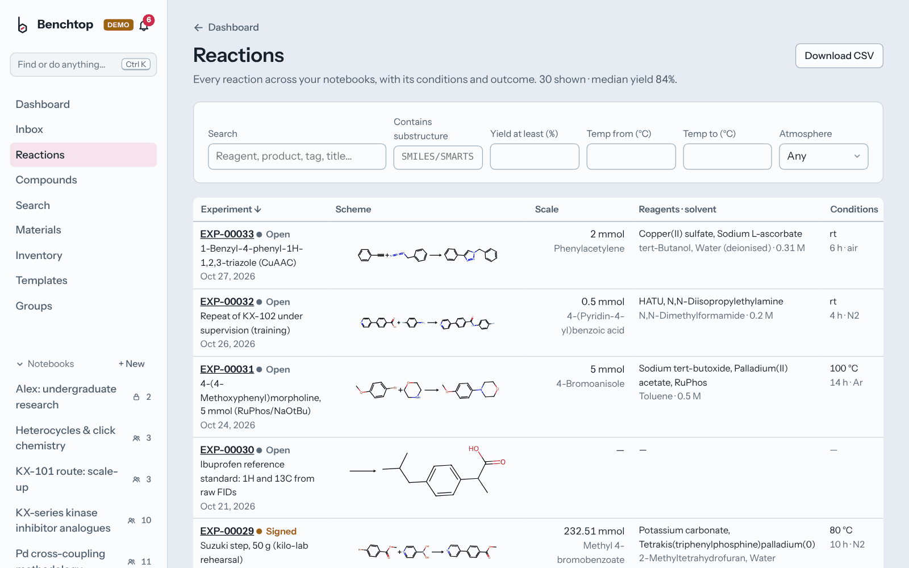

<p></p>

# Benchtop ELN

An open-source, self-hosted electronic lab notebook for synthetic chemistry. It covers the core
workflow of commercial chemistry ELNs such as Revvity Signals Notebook: notebooks of
experiments, a structure-aware stoichiometry table, a materials registry with lot-level
inventory, and an author/witness e-signature workflow backed by a tamper-evident audit trail.

This is a clean-room implementation built from publicly documented ELN concepts. It contains
no code, assets or data formats from any proprietary product and is not affiliated with Revvity.

**Website:** [juleslafargue.github.io/benchtop-eln](https://juleslafargue.github.io/benchtop-eln/) · **Download:** [latest release](https://github.com/juleslafargue/benchtop-eln/releases/latest)



## A look around

All screenshots come from the built-in demo lab (`./benchtop demo`): a fictional research group and
three months of their work. Nothing in them is real data.

**Spectra.** A raw Bruker FID of ibuprofen, phased and processed in the browser, auto-integrated and
assigned against predicted shifts (atom numbers match the structure):


<table>
<tr>
<td width="62%"><br>
<b>Have we done this before?</b> Similar reactions the lab has already run, with conditions, yields and
notes, under every reaction table, including the failures.</td>
<td width="38%" align="center"><br>
<b>Discussion.</b> Threads on any section, with @mentions and notifications, even on signed records.</td>
</tr>
<tr>
<td colspan="2"><br>
<b>Dashboard.</b> What's waiting for your signature, the lab's yields over time, low or expiring stock and
recent spectra. Everyone arranges their own.</td>
</tr>
<tr>
<td><br>
<b>Reactions overview.</b> Every reaction you can see, filterable by substructure, yield, temperature and
atmosphere, and exportable as CSV.</td>
<td><br>
<b>Screening grids.</b> Two-factor screens as a heatmap with the best conditions picked out.</td>
</tr>
<tr>
<td colspan="2"><br>
<b>Groups.</b> Research groups with leads; each notebook is open to everyone, to one group, or kept private.</td>
</tr>
</table>

**Impurity checks, in dark mode.** Residual solvents are recognised and quantified (here 3.6 mol% EtOAc)
and kept out of the integrals:


## What it does

| Area | Features |
|---|---|
| **Notebooks & experiments** | Notebooks hold experiments (`EXP-00042`). Each experiment is a stack of sections (add one from the *Add section* menu at the top, between any two sections, or at the end): rich text (sub/superscript, tables, chemistry symbols), reaction, data table, files, references. Tags, templates, duplicate, printable report and JSON export. |
| **Chemistry** | Draw structures and reactions in [Ketcher](https://github.com/epam/ketcher) (runs fully in the browser via WebAssembly). Drawing a reaction fills the stoichiometry table automatically, keeping counter-ions together (NaBH₄ stays one row). RDKit computes MW, formula, InChIKey and depictions server-side. |
| **Conditions** | Temperature (or rt/reflux), time, atmosphere and target concentration as real fields. Tick *fill to target M* on a solvent and its volume is calculated for you. |
| **Stoichiometry** | Enter mass, volume, mmol or equivalents in any row; the rest is calculated from the limiting reagent, accounting for purity, density (neat liquids) and molarity (solutions). Products get theoretical mass and % yield. The cell you typed is highlighted so you always know what's input vs. calculated. |
| **Work-up & characterisation** | Purification sections (method, stationary phase, eluent, Rf, isolated mass, appearance) and characterisation sections (¹H/¹³C NMR, HRMS, IR, mp, Rf, HPLC…), each item linkable to its data file. |
| **Spectra** | Drag spectrum files onto an experiment: JCAMP-DX (incl. compressed SQZ/DIF/DUP, TopSpin's NTUPLES export and multi-block files such as MestReNova's), zipped Bruker experiments (processed `pdata/*/1r`, or just the raw `fid`) and two-column CSV become characterisation items with technique, frequency and solvent filled in, and open already analysed. ¹H auto-analysis finds the signals, cuts out solvent/water/TMS lines (where they actually are), and scales integrals to the product formula's proton count; ¹³C gets a signal-to-noise peak list without the solvent. A note offers one-click referencing when the solvent residual is off. Viewing is inline or full-screen. Scroll to zoom at the cursor, shift-scroll to pan, live δ/Hz readout. Integrate by dragging: running integral curves are drawn over the peaks with values under the axis. Each ¹H signal is classified (s, d, t, q, p, sext, hept, dd, dt, td, ddd, dq, m) with J in Hz, and you can override any multiplicity or J in the signals table. Type a proton count in any row to make it the reference. Click a peak to reference the axis (solvent residuals for CDCl₃, DMSO-d₆, CD₃OD, C₆D₆, D₂O, CD₂Cl₂, acetone-d₆, CD₃CN are marked and offered as one-click references). Integrated ¹H signals are labelled above the spectrum ("7.42 t, 2H") with leader lines to each multiplet, and integral values below the axis never overlap. Export a clean PNG for SI or slides. Everything is saved with the record. |
| **Raw FID processing** | Zip a Bruker experiment folder straight off the spectrometer, without processing it in TopSpin, and drop it in: Benchtop does the Fourier transform in your browser (exponential line broadening, zero filling, digital-filter group-delay removal, automatic phasing by entropy minimisation and polynomial baseline correction). FIDs saved as JCAMP-DX open the same way: TopSpin's export, and benchtop spectrometers (Nanalysis, Oxford Instruments), whose first few points are missed by the instrument and rebuilt by backward linear prediction. Phase 0/1 sliders, an *Auto phase* button and a line-broadening choice are there if you want to adjust it; your settings are saved with the record. Checked against TopSpin on ibuprofen (¹H spectra correlate at 0.99; ¹³C peaks agree within 0.01 ppm). 1D only: 2D experiments and series (COSY, HSQC, T1) are recognised and kept with the record as files. |
| **Predicted NMR shifts** | When an experiment has a drawn product, its ¹H and ¹³C spectra show predicted shifts from [NMRShiftDB2](https://nmrshiftdb.nmr.uni-koeln.de), an open database of assigned spectra, as a purple lane above the spectrum. Each observed signal gets an *Assigned to* column (atom numbers match a numbered structure), and a panel lists every predicted group with its confidence and the observed shift it matched, flagging groups with no signal and signals no group explains. Prediction looks up each atom's surroundings out to four bonds (HOSE-style) in a table of 43,213 assigned structures (359,155 ¹³C and 125,904 ¹H shifts) that ships with Benchtop. It starts from the closest atoms and refines the estimate with each wider sphere that has data, weighted by how many examples back it, and uses outlier-trimmed averages so a mis-assigned database entry can't drag a prediction off. On 2,089 structures held out of the table: median error 0.89 ppm for ¹³C and 0.10 ppm for ¹H (mean 2.3 and 0.25 ppm); for "high" confidence atoms 0.45 and 0.06 ppm. Run `python -m app.nmrdata --benchmark <file.sd>` to reproduce this. A CH₂ next to a stereocentre, or at the end of a C=C (styrene, acrylates), is listed as two diastereotopic protons that can match separate signals. **It learns from your lab:** check the assignments in the panel (change any with its menu) and *Confirm*; once the experiment is signed, those shifts are used on top of NMRShiftDB2 for the same atom environments in future predictions (marked *lab*), and withdrawing or voiding takes them back out. Auto-analysis also uses the prediction so a product's own signals aren't mistaken for residual solvent. Benchtop checks for a newer NMRShiftDB2 export every 30 days and rebuilds the table on your computer when there is one (Admin → *Update now*, or `./benchtop update-nmr-data`). Second-order effects aren't modelled; it's a check, not a substitute for assigning. |
| **Spectrum checks** | Auto-analysis flags residual lab solvents (EtOAc, hexane, acetone, DCM, Et₂O, THF, MeOH, toluene, DMF, Et₃N, silicone grease and more, from the Fulmer 2010 tables for CDCl₃, DMSO-d₆ and CD₃OD) only when every one of their signals is present, and reports each as mol% and wt% with an overall purity estimate. A checks panel compares the spectrum with the drawn product: total ¹H integral vs. the formula (allowing for exchangeable OH/NH), number of signals vs. symmetry-distinct H environments, ¹³C peaks vs. unique carbons, and warns when a minor set of signals looks like a second compound. *Compare* overlays up to four other spectra (starting material, crude, a reference), stacked or overlaid, and the overlay is saved with the record. |
| **HRMS helper** | On HRMS/MS items, pick the adduct ([M+H]⁺, [M+Na]⁺, [M+K]⁺, [M+NH₄]⁺, M⁺, [M−H]⁻), get the calculated m/z from the product structure (monoisotopic, electron mass corrected), type the found value and see the error in ppm; *Use* writes the standard `calcd for … ; found …` line. |
| **Instrument folders** | Point Benchtop at the folders your instruments save to (*Admin → Instruments*): a local folder, a mounted network drive, or OneDrive/Dropbox, one per instrument. A file or dataset whose name, folder or title carries an experiment number (`EXP-00042`) or a sample code (`JL-013`) is attached to that draft's *Instrument data* section once it has finished copying, and its author is notified. Bruker and Agilent/Varian NMR datasets arrive as one zip each (Bruker spectra open in the viewer straight away); LC-MS, HPLC and GC vendor data (Agilent/Bruker `.D`, Waters and Thermo `.raw`, Sciex `.wiff`, Shimadzu, mzML) is stored as it is, up to 2 GB per run, with any PDF or CSV report alongside. Benchtop only reads these folders, never moves or deletes anything, and what was already there when a folder was added is left alone. |
| **Inbox** | Anything Benchtop can't place with certainty (no number, two numbers, a code nobody handed out, a typo) waits in the Inbox with a plain note saying why; it never guesses. Assign it to a draft in one click, or set it aside. Each person only sees what the sharing rules allow: files that name an experiment are shown to the people who can read it, a code's unknown number only to its owner, and unmatched files to everyone or to the groups an admin chose for that instrument. A file that landed in the wrong draft goes back with *Not mine*. |
| **Sample codes & follow-ups** | Everyone picks their initials once (*Account → Sample codes*); *New sample code* on an experiment hands out the next number (`JL-013`) to write on the vial and type as the instrument's sample name. Signed records are never changed: results that come back later (HRMS, elemental analysis) go into a *follow-up*, a new draft linked to the signed record both ways, made from the Inbox or the record's page. |
| **Dashboard** | The home page is a grid of widgets you arrange yourself: work lists (waiting for my witness signature, with what you've been asked to witness first and overdue ones marked; my records waiting for a witness; returned to me with the reason, my open experiments, recently edited, pinned), quick actions, sticky notes and section headings, a yield-over-time chart (click a point to open the experiment), this month's activity, recent spectra, and inventory alerts (lots below 20 % of what was received, or expiring within 30 days). *Customise* lets you drag, resize, add and remove widgets; the layout is saved to your account. Pin any experiment from its page. On a phone the widgets stack in one column. |
| **Write-up drafts** | *Draft write-up* composes an SI-style experimental paragraph from the reaction table, conditions, work-up and characterisation (amounts with sensible significant figures, mol% for catalysts, yield). It never guesses: anything missing is listed instead. Copy as rich text or add it as a section. |
| **Obsidian export** | Every experiment as a Markdown note with Dataview-ready front matter (status, product, yield, temperature, time…), the scheme as SVG, tables and attachments. `./benchtop export-obsidian <folder>` or set `BENCHTOP_OBSIDIAN_DIR` to sync hourly; an index note includes a ready-made Dataview table. |
| **Moving records in and out (.eln)** | Export one experiment, a notebook, or everything you can open as a **.eln** file, the shared format of electronic lab notebooks (the [ELN Consortium](https://github.com/TheELNConsortium/TheELNFileFormat)'s RO-Crate format, which eLabFTW, RSpace, Kadi4Mat, SampleDB, Chemotion and others read and write). Each record carries its printable report, every file with its SHA-256, structures as MOL/RXN files, comments, signatures with their timestamp proofs, and Benchtop's full record for a lossless move to another Benchtop. **Import** shows what's inside first (experiments, authors, files, which were signed), then brings in what you tick: write-ups, extra fields, steps, comments and files, each file checked against the fingerprint the other system recorded. Records signed or locked there arrive read-only; nothing is ever turned into a Benchtop signature. |
| **Have we done this before?** | Under every reaction table, the most similar reactions anyone in the lab has already run (that you're allowed to see), as you draw it, even before there's a product. Reactions are compared by starting materials and products, by the transformation itself (which structural features appear and disappear) and by reagents and solvents, and labelled *same reaction*, *same transformation on a different substrate*, *same product* or *similar starting materials*. Each shows the scheme, who ran it and when, the conditions, the yield and the observations; *Use these conditions* copies the reagents, catalysts, solvents (as equivalents, so they scale) and conditions into your table. |
| **Reactions overview** | Every reaction across notebooks in one table: scheme, scale, reagents, conditions, yield, purification, data recorded. Filter by text, substructure, yield and temperature; sort; download CSV. |
| **Safety data (GHS)** | Hazard classifications come from PubChem's public API, which gathers them from the EU CLP harmonised classification (Annex VI), the ECHA C&L Inventory (with the share of notifiers behind each statement), Japan's NITE, Safe Work Australia and HSDB. Benchtop uses the most authoritative source for each chemical (harmonised, then the largest ECHA aggregate) and still lists anything other sources add. Every record shows its source and when it was fetched. Data older than 30 days is re-checked automatically while Benchtop runs. If a classification changes (say a new H350), the change goes into the audit log and onto your dashboard until someone marks it reviewed. Offline, the last data is kept and its age shown. Special hazards (pyrophoric, water-reactive, peroxide former, oxidiser, CMR, acid-gas, explosive) are flagged from the official codes. Supplier SDSs still take precedence. |
| **Risk assessment** | New experiments include a *Safety & risk assessment* section that reads the reaction table and shows every chemical's pictograms, signal word and H-statements, plus warnings for known dangerous combinations (azides with CH₂Cl₂, NaH in DMF/DMSO, water-reactive reagents with water or alcohols, oxidisers with flammables) and controls suggested from the P-statements. *Record hazards in notebook* saves a snapshot into the record (so a signed record keeps what was known at signing), and a banner appears if the reaction or the classifications change afterwards. |
| **Reagent lookup** | Type a name, CAS number or SMILES to fill in a new material (structure, MW, CAS, density, hazards) from PubChem, or to add a compound to a reaction straight from *Add from registry* without registering it first. |
| **Green metrics** | Atom economy, reaction mass efficiency, E-factor, PMI and solvent L/kg under every reaction table and in the Reactions overview (reaction only; work-up and purification aren't counted). |
| **Scale-up** | *Repeat at another scale* creates a new experiment at ×N (or a target mmol of the limiting reagent): typed amounts scale, equivalents don't, fill-to-concentration solvents recalculate, results and the risk assessment start fresh. |
| **References** | A *References* section lists the papers an experiment relies on. Paste a DOI (or a doi.org link) and Benchtop fills in the title, authors, journal, year, volume, issue and pages from doi.org, which covers journal articles (Crossref) and datasets (DataCite, e.g. Zenodo). Each reference shows in ACS style with a link to the paper, can carry a note ("impurity table for CDCl₃"), and can be typed in by hand when there's no DOI or no internet. References appear in reports, PDFs, Markdown and search, and .eln exports list them as citations other ELNs can read. |
| **Screening grids** | A two-factor screening section (e.g. base × temperature) with a heatmap of yields or any other response, best result highlighted, and each cell optionally linked to the experiment that produced it. |
| **Compounds** | Every product and registered sample with cLogP, TPSA, HBD/HBA, rotatable bonds, Fsp³, QED and Lipinski/Veber flags (RDKit, on the parent structure), sortable, with a drug-like filter. |
| **Materials & inventory** | Structure-deduplicated registry (`MAT-00007`) with CAS, density, hazards. Lots/containers with barcode, location, supplier, purity. Every withdrawal is a ledger entry with unit conversion (g ↔ mL via density). One click deducts a reaction's reagents from their lots (after showing exactly what will be taken), and each deduction can be undone; one click registers an isolated product as a new material + lot linked back to the experiment. |
| **Search** | Results as you type. Every word must match, in any order, anywhere in an experiment: title, tags, ID, notebook, author, section text, reagent names, conditions ("80" finds 80 °C, not 0.9808), table values and file names; "quoted phrases" match exactly. Matches are highlighted with the section they came from. Filter by status, notebook or your own experiments; separate tabs for experiments, materials (incl. CAS and lot barcodes) and files. **Substructure** search highlights the matching atoms on every structure; **similarity** search shows a score bar with a live threshold slider. Recent searches, keyboard navigation (↓ into results, Enter to open) and shareable URLs. |
| **Signing** | Author signs → record locks → a different user witnesses (or returns it with a reason). Signing requires password re-entry. Each signature stores a SHA-256 hash of the full record (all sections + attachment hashes); *Verify integrity* recomputes it and flags out-of-band edits. Records can be voided, never deleted. |
| **Witness requests & email** | When signing, the author can ask a particular colleague to witness. They get a notification and an email, a reminder every few days while it waits, and an "overdue" mark after a week (both adjustable); it's first on their dashboard. The author hears back by email when it's witnessed or returned (with the reason), can send a reminder or ask someone else. Email goes through your own mail server or a Gmail/Outlook/iCloud account (Admin → Email, with a test button and a log); everyone chooses which emails they get. Without email, it all still works as notifications. |
| **Trusted timestamps** | Every signature is also certified by an independent RFC 3161 timestamp authority (DigiCert by default; Sectigo, GlobalSign, FreeTSA or your own), the same standard used for patent evidence and by industry ELNs. Only a SHA-256 fingerprint of the signature is sent, never the record. Each signature shows the certified time and offers a *Proof* download (the token, the exact text timestamped, and the `openssl ts -verify` command) so anyone can check it without trusting Benchtop. Offline, signing still works and the timestamp is fetched later. `./benchtop check` re-verifies every token. |
| **History & audit** | Every section save is a new version (view any past version). Every mutation, login and failed signature attempt is written to an append-only audit log where each event hashes the previous one; *Verify hash chain* detects any altered, removed or reordered event. Attachments are content-addressed and checked against their hash on download. |
| **Quick navigation** | ⌘K (Ctrl K) finds any experiment, material (by name or CAS), notebook or page, and runs actions such as "New experiment"; press N anywhere for a new experiment. Amount fields accept units: `1.2 g` in a mg cell, `250 µL` in mL, `0.5 mol`, `30 min`, `500 mM`. |
| **Groups & sharing** | Research groups with leads (a PI, a manager) and members. Each notebook is open to everyone, to one group, or private (plus its group's leads, who see all of their group's notebooks). Share a single experiment with anyone, to view or to edit; only the author signs. Records someone can't open don't appear anywhere for them: lists, search, reactions, compounds, dashboard, spectra and similar-reaction suggestions all respect it. Existing notebooks stay open to everyone until you change them. |
| **Comments & notifications** | Discuss any experiment or a single section in threads: ask about a peak, request a change, approve. @mention people (autocomplete as you type) and they're notified; replies and comments on your experiments notify you too, via the bell. Resolve threads when done. Comments can be added during review and after signing because they aren't part of the signed record (the signed hash doesn't change), and every comment, edit, deletion and resolution is in the audit trail. Mention someone who can't open the record and Benchtop offers to share it with them. |
| **At the bench** | Press **L** on an experiment to log a timestamped line ("14:32 added NaH portionwise") to its bench log without scrolling; **T** starts a timer (or type "30 min stir"), which runs in the sidebar, rings, notifies and records "Stir: 30 min done (14:32–15:02)". **P** shows a QR code that opens the experiment on your phone, already signed in (one-time code, 5 minutes): take photos of TLC plates straight into the record, log notes and run timers one-handed (needs `./benchtop lab` or a server, so the phone can reach Benchtop). |
| **Everyday comforts** | Typing `EXP-00025` or `MAT-00007` in any text makes a link with a hover preview (title, status, structure). Paste or drop pictures straight into text sections; they're saved as files of the record. Removing a section offers *Undo*. ⌘S saves at once, and **?** lists every shortcut. *Add from registry* offers your usual reagents first, with the role and lot you last used. The dashboard nudges you about drafts untouched for two weeks. **Download PDF** gives an A4 record with scheme, tables, pictures, signatures and the content hash. |
| **Plugins** | Add your lab's own section types and instrument-file readers with a small text file, no code: a glovebox log, a hydrogenation safety checklist, a cell-passage record; fields with units, dropdowns, warnings when a value is out of range, checklists and tables. Items marked *required* must be done before the author can sign. Readers teach Benchtop to open an instrument's CSV or text export (an HPLC trace, a UV-vis spectrum) as a chart. Admins add plugin files from *Admin → Plugins*; each section keeps a copy of its definition, so records stay readable if a plugin changes or is removed. Three examples ship switched off. See [docs/PLUGINS.md](docs/PLUGINS.md). |
| **API tokens & webhooks** | Personal access tokens (read only, or read & write, with an expiry) for scripts and instrument PCs; they act as you but can never sign records or change settings. Webhooks post to Slack, Teams or your own service when an experiment is signed, witnessed, returned, voided or commented on, signed with HMAC-SHA256, retried in the background, with a delivery history. Only identifiers and titles are sent, never record content. See [docs/API.md](docs/API.md). |
| **Users & accounts** | Admin, scientist and read-only viewer roles. A fresh install opens on a setup screen where you create your own administrator account (the built-in admin login is then retired). **Single sign-on** with Microsoft 365 / Entra ID, Google Workspace or any OpenID Connect provider: people sign in with their university or company account, optionally limited to your email domains, with accounts created on first sign-in or matched to ones an admin added. Sign-ins can last 30 days. Everyone has an account page to change their name, email, username and password, and preferences (five colour themes, each in light and dark: Benchtop, Lab notebook, Fume hood, Litmus and High contrast; default notebook; open spectra full-screen) that follow them between computers. Signatures store the printed name at the moment of signing, so later name changes never alter signed records. An optional ORCID iD (checked for typos) names you in exports. Admins can edit any account. |

## Which computer?

| You have | Go to |
|---|---|
| A Mac | [Quick start (Mac)](#quick-start-mac) |
| A Linux computer | [Quick start (Linux)](#quick-start-linux) |
| A Windows PC | [On Windows](#on-windows) |
| Labmates who should use your Benchtop | Nothing to install for them: they open it in their browser, on any computer or phone. See [docs/SERVER.md](docs/SERVER.md) |

## Quick start (Mac)

Double-click **Benchtop.command** in the folder, or run:

```bash
./benchtop            # first run sets everything up, then opens your browser
```

Benchtop runs while that Terminal window is open; close it (or press Ctrl+C) to stop. On a fresh install it
asks you to create your own account (you become the administrator) and can add a demo notebook.
Needs Python 3.11+ (python.org). Node is only needed when the interface has to be built: release zips include it
ready-built; a download of the GitHub repository doesn't, so install Node (nodejs.org, LTS) for that.

If macOS says *"Benchtop.command" Not Opened* because Apple couldn't verify it, click **Done** (not Move to Trash),
then **System Settings → Privacy & Security → Open Anyway**. Or skip double-clicking: in Terminal, `cd` into the folder
and run `./benchtop`. Unzipping with `unzip` in Terminal (instead of double-clicking the zip) avoids the warning entirely.

**Use it like an app.** In Safari choose *File → Add to Dock*, or in Chrome/Edge click the install icon in the
address bar (or *Install Benchtop* in Account settings): Benchtop gets its own window and Dock icon. It's a window
onto the same notebook (nothing is stored in it), so upgrades show the next time it opens; Benchtop itself still needs
to be running.

```bash
./benchtop status               # running? which version? where is the data?
./benchtop lab                  # share it with labmates on the same network
./benchtop update               # install the newest version (see Updating, below)
./benchtop rollback             # go back to the version from before the last update
./benchtop backup | backups | restore FILE   # restore without FILE lists your backups
./benchtop check                # is everything intact? (database, audit trail, signed records, files)
./benchtop check FILE           # the same checks on a backup, without changing anything
./benchtop seed                 # demo data
./benchtop export-obsidian ~/Documents/Vault/Benchtop
./benchtop update-nmr-data      # rebuild the NMR shift table from the latest NMRShiftDB2 export
./benchtop update-nmr-data FILE.sd   # …or from a nmrshiftdb2withsignals.sd you downloaded
```

### Updating

When a new version is out, the administrator's dashboard says so (Benchtop looks at its GitHub Releases page
once a day; it never installs anything by itself). To update, close Benchtop's window, then in Terminal, in the
Benchtop folder:

```bash
./benchtop update        # shows what's new and asks; then backs up, updates and gets everything ready
./benchtop rollback      # if something isn't right: back to the version you had, your data as it is
```

`update` refuses while Benchtop is running, and changes nothing if the backup fails or the download is damaged.
It works for both kinds of install: a copy cloned from GitHub (it moves to the newest *release*, so you only
get versions that passed all the automatic tests; GitHub Desktop stays in step) and an unzipped release (it
downloads the new zip and checks its fingerprint). Your data, settings and backups are never touched, nor
anything else you keep in the Benchtop folder. `./benchtop update --check` only looks.

Rolling back keeps your data as it is now, so nothing you recorded after the update is lost. Most updates
don't change how the data is stored; if one did, `rollback` says so and offers the backup made just before
the update instead (which would bring back the data as it was then).

However the new version arrived (`update`, merging in GitHub Desktop, `git pull`, a copied folder), Benchtop
backs up your data by itself on its first start whenever it is about to change how the data is stored, and
says so in the Terminal window. That backup keeps the old format, so the previous version can restore it. If
the backup fails, Benchtop doesn't start and changes nothing.

Versions before 0.19 don't have `update` yet. Once: with a GitHub clone, *Fetch origin* then *Pull origin* in
GitHub Desktop (or `git pull`); with a zip, download `benchtop-eln-vX.Y.Z.zip` from the
[Releases page](https://github.com/juleslafargue/benchtop-eln/releases) and run
`./benchtop upgrade ~/Downloads/benchtop-eln-vX.Y.Z.zip`. A lab server updates with one command too:
`deploy/update-server.sh` (docs/SERVER.md).

Backups are automatic: one on start-up if the newest is more than a day old, then daily while running,
keeping the newest 14. Each is a zip with a consistent database snapshot and the audit trail's latest
fingerprint. Attached files are kept **once** for all backups, in a `benchtop-files` folder beside the
zips: files never change once attached, so each backup only adds the new ones, and 1 GB of spectra costs
about 1 GB of backup space rather than 1 GB per backup kept. In **Admin → Backups**, choose a *second
copy* folder (iCloud Drive or an external drive) and every backup is copied there too, its files first.
Once a week Benchtop unpacks the newest backup into a temporary folder and checks it as if it had been
restored, so you know your backups actually work; problems show on the admin's dashboard.

**Daily data check.** Once a day Benchtop also checks the data it is using, in the background: the database file,
the audit trail, that every signed record still matches its signature, trusted timestamps, and that every attached
file is there and unchanged. A failing disk, or a file changed or deleted outside Benchtop, shows up the next day.
Problems show on the admin's dashboard and in **Admin → Backups**, saying what to do, and admins with an email
address get one email when a problem first appears. A missing or changed attached file can be put back from the
backups with one click (*Put back from backups*; the damaged copy is kept aside, and nothing else changes). Attached
files are re-read byte for byte every day while they total up to 20 GB; above that, every file is checked for size
daily and a seventh of them are re-read each day, so each is re-read once a week. On a Postgres server the daily
check doesn't run, and Admin says so.

**Disk space.** A full disk makes saving, uploads and backups fail, so admins are warned early: on the dashboard and
in **Admin → Backups** when the disk with Benchtop's data (or the one with the backups, or their second copy) has less
than 5 GB free, with what to do (`BENCHTOP_DISK_WARN_GB` sets the amount; `0` turns it off). Benchtop also keeps the
last 1 GB for saving what people type: an upload, an instrument file or an import that would leave less is refused
with a plain message (an instrument file waits in its folder and comes in once there's room), and so is a backup that
wouldn't fit. On a Mac, Finder can show more space "available" than Benchtop does, as it also counts space macOS can
free by itself; Benchtop counts what's free now.

When you move or copy backups, take the zip **and** the `benchtop-files` folder beside it. Backups made
before 0.15 hold their files inside the zip and still restore as before.

**Want to explore with realistic data first?** `./benchtop demo` opens a demo lab on
http://localhost:8001, kept completely apart from your own notebook: the fictional Ruiz group
(a PI, a postdoc, PhD students, an undergraduate, a process chemist, a lab manager and a read-only
collaborator) and three months of their work. It includes a Suzuki substrate scope, base × solvent and
ligand × base screens, the KX-101 med-chem series (Suzuki, hydrolysis, HATU amides incl. a failed hindered
aniline, Boc chemistry, reductive amination), a 1 g → 10 g → 50 g process scale-up with IPC data and Pd
levels, NaH/DMF and azide safety cases, CuAAC, teaching-lab preps, and an ibuprofen reference with real raw
FIDs. Records are witnessed, signed, returned and voided; there are comment threads, shares, inventory use and
spectra to analyse. The sign-in page lists everyone; click a name to see Benchtop as them.
`./benchtop demo --reset` rebuilds it.

**Using it as a group?** See [docs/SERVER.md](docs/SERVER.md): a lab Mac on the local network
(`./benchtop lab`), the same over Tailscale from anywhere, or a server with HTTPS, backups and single
sign-on (`deploy/`).

## Quick start (Linux)

Benchtop runs on Linux with the same `./benchtop` launcher as on a Mac (GitHub tests every change on Ubuntu).
These steps are for Ubuntu or Debian; other distributions need the same three things from their own package manager.

1. Check you have Python 3.11 or newer: `python3 --version` (Ubuntu 24.04 has 3.12; Ubuntu 22.04's 3.10 is too old).
2. Install what the launcher uses:

   ```bash
   sudo apt update && sudo apt install -y python3-venv curl unzip
   ```

3. Download `benchtop-eln-vX.Y.Z.zip` from the [Releases page](https://github.com/juleslafargue/benchtop-eln/releases),
   then unzip it and start Benchtop:

   ```bash
   cd ~ && unzip ~/Downloads/benchtop-eln-v*.zip
   cd ~/benchtop && ./benchtop
   ```

The first start sets everything up (a minute or two), then opens your browser; if it can't, it prints the address
to open (http://localhost:8000). Leave that terminal window open while you work; close it or press Ctrl+C to stop.

From here everything works as on a Mac: the commands listed in [Quick start (Mac)](#quick-start-mac), updating and
rolling back, backups, `./benchtop demo` and `./benchtop lab` for labmates on the same network. The Mac-only parts are
double-clicking `Benchtop.command` (on Linux, run `./benchtop` in a terminal) and Safari's *Add to Dock* (Chrome's
*Install Benchtop* works on Linux too).

## On Windows

**Labmates on Windows don't need anything installed.** When Benchtop runs on a Mac (`./benchtop lab`) or a lab server,
they open it in Edge or Chrome like any website.

**To run your own copy on a Windows PC**, use WSL, Microsoft's free "Linux inside Windows". Benchtop then runs exactly
as it does on Linux. There's no double-click starter for Windows itself yet (it's on the [roadmap](#roadmap-ideas)).

1. Open **PowerShell as administrator** (right-click the Start button → *Terminal (Admin)*, or *Windows PowerShell
   (Admin)* on Windows 10), run `wsl --install`, then restart the PC. This installs Ubuntu. On a university- or
   company-managed PC this may need your IT team.
2. Open **Ubuntu** from the Start menu and choose a username and password when asked (this is only for Ubuntu).
3. In the Ubuntu window, install what the launcher uses:

   ```bash
   sudo apt update && sudo apt install -y python3-venv curl unzip
   ```

4. Download `benchtop-eln-vX.Y.Z.zip` from the [Releases page](https://github.com/juleslafargue/benchtop-eln/releases)
   with your usual browser, then in the Ubuntu window (put your Windows user name in place of `YOU`):

   ```bash
   cd ~ && unzip /mnt/c/Users/YOU/Downloads/benchtop-eln-v*.zip
   cd ~/benchtop && ./benchtop
   ```

5. Open http://localhost:8000 in Edge or Chrome. Leave the Ubuntu window open while you work; close it or press
   Ctrl+C to stop. Next time, open Ubuntu and run `cd ~/benchtop && ./benchtop`.

Good to know:

- **Unzip it inside Ubuntu, as above**, not with Windows' File Explorer, and don't run a copy that sits in a Windows
  folder (`/mnt/c/…`). Windows tools can change the launcher's line endings or permissions, and then it won't start.
  For the same reason, if you use Git, clone inside Ubuntu rather than with GitHub Desktop for Windows.
- **Your records live inside Ubuntu.** File Explorer shows them under *Linux → Ubuntu → home → (your Ubuntu name)
  → benchtop → backend → data* (on Windows 10, type `\\wsl$\Ubuntu\home` in the address bar). For a backup copy
  outside Ubuntu, make a folder in Windows, then type its path as the *second copy* in **Admin → Backups**, for example
  `/mnt/c/Users/YOU/OneDrive/Benchtop backups`.
- **Updating** works as on a Mac: `./benchtop update` in the Ubuntu window ([Updating](#updating)).
- **Sharing with labmates** (`./benchtop lab`) isn't set up for WSL: Windows keeps WSL hidden from the network by
  default. For a lab, run Benchtop on a Mac, a Linux computer or a server ([docs/SERVER.md](docs/SERVER.md)).
- **Docker Desktop** is another way: [Quick start (Docker)](#quick-start-docker) works on Windows too.

## Quick start (Docker)

```bash
docker compose up -d --build
docker compose exec app python -m app.seed   # optional demo data
```

Then open http://localhost:8000 in your browser (on a Mac, Linux, or Windows with Docker Desktop).

Sign in as `admin` with the password in `BENCHTOP_ADMIN_PASSWORD` (default in compose: `change-me-now`).
The demo seed adds **alice** (author) and **bob** (witness), both `benchtop123`, a reagent
registry with lots, a template and a worked Suzuki coupling.

For a server that a group uses, follow [docs/SERVER.md](docs/SERVER.md): it adds HTTPS, single sign-on and
a second copy of the backups. Benchtop uses its standard database (SQLite) there too, so the built-in backups,
restore test and `./benchtop check` all work; SQLite is plenty for a research group.

## Instrument data: using it well

Getting data from the NMR or the LC-MS into the right experiment without uploading anything by hand works best
with a few habits.

**Setting it up (an admin, once per instrument).**

1. **One folder per instrument, as small as possible.** On a departmental NMR, choose your group's own subfolder,
   not the whole data drive: it's quicker to look through every minute, and other groups' file names stay out of
   your Inbox.
2. **Choose the right type.** *Bruker NMR* and *Agilent / Varian NMR* keep each dataset together as one zip;
   *LC-MS, HPLC or GC* keeps vendor data (`.D`, `.raw`, `.wiff`) together; *Any files* is for instruments that
   export single files (IR, UV, PDF reports).
3. **Use *Check folder* before saving.** It shows what Benchtop would do with the newest files, without doing it.
   If most of them would go to the Inbox, sort out the naming first (see below).
4. **Say who sees unmatched files.** For a shared instrument, limit it to your group: file names can give away
   compounds and projects.
5. **Match the quiet time to how files arrive.** Benchtop waits until nothing has changed for this long, so it
   never takes half a file. 2 minutes suits NMR on a network drive; 5 minutes suits LC-MS runs, which keep writing
   while they acquire; make it 10 minutes or more for OneDrive or slow USB copies.
6. **Leave "only new files" on**, unless you really want older data. Then pick a start date and check the count
   in *Check folder* first: ten years of departmental NMR data would flood the Inbox. To bring in only some of
   what was already there, use *Choose some to take* on the folder's row later: it lists that data (filter it
   by name, e.g. an experiment number) with where each would go, and you tick the ones you want.
7. **Give Benchtop read-only access** where you can (a read-only share or mount). It never changes anything,
   but read-only means it can't, even by mistake.
8. **Pause rather than remove** an instrument that's offline for a while (a service visit). Removing stops
   watching for good, though everything it already brought in stays.
9. **Glance at Admin → Instruments now and then.** Each folder says when it was last checked, and in red if
   something needs you: a disconnected drive, a file Benchtop isn't allowed to read, or a full disk.

**Every day (everyone).**

1. **Choose your initials once**, in *Account → Sample codes* (e.g. `JL`).
2. **Before you go to the instrument, click *New sample code*** on the experiment. Write the code on the vial
   (`JL-013`) and type it as the sample name in TopSpin, IconNMR, VnmrJ or the LC software. Adding a date is
   fine (`JL-013-20261021`). Typing the experiment number (`EXP-00042`) works too.
3. **Use one code per sample, not per experiment.** The crude and the purified product get their own codes;
   both can belong to the same experiment. Never give the same code to two experiments.
4. **Keep the separator.** `JL-013`, `JL_013` and `JL 013` are understood; `jl13` isn't, on purpose, so a
   stray "jl13" in a file name can't attach data to the wrong record.
5. **Look at the Inbox when its number appears in the menu.** Files wait there with a reason. Assign each one
   rather than downloading and uploading it again: the record then shows where it came from.
6. **Use *Not mine*** if someone else's spectrum lands in your experiment (a mistyped number). It goes back to the
   Inbox for its owner, and the audit trail records why.
7. **Sign once the data is in.** Files that arrive for a signed record are never added to it. Late results
   (HRMS, elemental analysis) go into a *follow-up*, which stays linked to the original.
8. **Don't rename or reorganise files in a watched folder afterwards.** A renamed file is a new file to Benchtop
   and arrives again (Benchtop won't attach the same content to a record twice, but a renamed file can end up in
   the Inbox). Reprocessing a dataset (in TopSpin, say) also arrives again, as a new version next to the first,
   so both are kept.

**Space and backups.** Instrument data is copied into Benchtop's data folder, so check the disk has room:
NMR is small (about a megabyte per ¹H dataset), but LC-MS runs can be hundreds of MB each. Backups keep each file
**once**, in the `benchtop-files` folder next to the backup zips, so they grow by about the same amount. When you
copy or move backups, take that folder too. For a second copy of a busy lab's data, an external drive is a better
fit than the free iCloud plan. Runs bigger than 2 GB wait in the Inbox unless you raise
`BENCHTOP_INSTRUMENT_MAX_MB`; very large high-resolution MS data can also simply stay on the instrument's drive.

**On a lab server** the feature works unchanged: mount each instrument share on the server (read-only) and use
those paths. [docs/SERVER.md](docs/SERVER.md#instrument-folders) has the steps for a Mac, OneDrive and Docker.

## Moving records in and out (.eln)

A **.eln** file is a zip that any modern lab notebook can open: a folder per experiment with its files, and a
description of each (title, people, dates, write-up, comments, tags). Benchtop writes the current version of the
format (RO-Crate 1.2, ELN format 1.2+20260923), checked on every change by the consortium's own validator.

**Taking your records with you.** *Account → Your records → Export everything (.eln)*: everything you can open,
every file included. Good for the end of a degree, a thesis appendix, or a data repository such as Zenodo (which
accepts RO-Crates). Each record has `report.html`, which reads in any browser, so the export is useful even with no
lab notebook at all. A notebook's page has *Export (.eln)* for just that notebook, and each experiment has
*Download .eln*.

**Bringing records in.** In the other system, export in its **.eln** format (eLabFTW, RSpace, Kadi4Mat and others
offer it among their export options), then open a Benchtop notebook and choose *Import .eln…*. Benchtop shows what's in the file before
adding anything: each experiment with its date, authors, files and whether it was signed there, and anything already
imported. Tick what you want and choose the notebook.

- Each imported experiment is a **new record owned by you**, with a new EXP number. A banner on it says where it
  came from, its original ID, dates and authors, and whether its files matched the fingerprints the other system
  recorded. The record as the other system described it is kept as `original-record.json`.
- Records **signed or locked there arrive read-only** (status *Locked*). Use *Make a follow-up* to carry the work on.
  Their signatures are shown as history, never as Benchtop signatures: Benchtop can't vouch for another system's
  signature. From another Benchtop, it also checks that the content is exactly what was signed.
- A file that **doesn't match** its recorded fingerprint is still imported but flagged, on the banner and in the
  *Imported files* table, since it may have been changed or damaged after export.
- Moving between **two Benchtops** keeps sections, reaction tables, spectra analyses and files exactly. Links to the
  other lab's inventory (lots and materials) are dropped, since they'd point at the wrong bottles here.
- Imports are recorded in the audit trail, as are exports.
- Folder and file names in an export unzip on any computer: shortened to fit (Chinese, Japanese and emoji names
  included) with the file extension kept, and never a name Windows reserves such as `CON` or `NUL`.

## Development

```bash
# API (Python 3.11+)
cd backend
pip install -r requirements-dev.txt
python -m app.seed                       # creates ./data with demo content
uvicorn app.main:app --reload            # http://localhost:8000/docs for the OpenAPI explorer
pytest -q
python tests/smoke_browser.py            # opens every page in a browser (needs: playwright install chromium, built frontend)
python tests/fuzz_api.py                 # thousands of odd requests to every endpoint; none may cause a server error
python tests/crash_test.py               # kills Benchtop mid-save, mid-backup, mid-upgrade and mid-restore; nothing may be lost

# Web app (Node 20+)
cd frontend
npm install
npm run dev                              # http://localhost:5173, proxies /api to :8000
```

To serve the built app from the API (what the Docker image does):
`npm run build`, then start uvicorn with `BENCHTOP_STATIC_DIR=../frontend/dist`.

**Automatic tests on GitHub.** `.github/workflows/tests.yml` runs on every push: the server tests, upgrades
from every past version, API fuzzing (thousands of odd requests to every endpoint), pull-the-plug tests (Benchtop killed
mid-save, mid-backup, mid-upgrade and mid-restore, then started again), a type-check and build of the app, and a browser pass over every page of the demo lab
on desktop, phone and dark mode (also on the oldest demo lab, upgraded). Results are in the repository's *Actions* tab. The workflow's source is
`deploy/github-tests.yml`; `./benchtop` keeps the copy in `.github/` up to date.

**Colour themes** are defined in `frontend/scripts/themes.py`, which checks every theme's text contrast and writes `src/themes.css` and `src/themeList.ts`; run `python3 scripts/themes.py` from `frontend/` after changing one.

**Database upgrades** live in `backend/app/migrations.py` as numbered steps; the database records which
it has had. A step must also work on an empty database and must never change content that a signature
covers. A Benchtop that finds data from a newer version refuses to start rather than misread it.

**Upgrade tests.** `backend/tests/upgrades/` holds a backup made by each released version's own code (from 0.7.1
on). `tests/test_v24_upgrades.py` restores each one with the current code, upgrades it and checks that every row
is still there and unchanged, `./benchtop check` passes, and every record and attached file opens. `pytest` tries
five of them; `BENCHTOP_UPGRADE_TESTS=all pytest tests/test_v24_upgrades.py` tries them all (GitHub does, on every
push). When releasing a version, add its backup: `python3 tests/make_upgrade_fixture.py` (from `backend/`).

### Configuration

| Variable | Default | |
|---|---|---|
| `BENCHTOP_DATA_DIR` | `./data` | SQLite file, attachments, generated secret key |
| `BENCHTOP_DATABASE_URL` | SQLite in data dir | Any SQLAlchemy URL, e.g. `postgresql+psycopg://…`. Built-in backups, restore and `check` need SQLite; with anything else, back up yourself (docs/SERVER.md) |
| `BENCHTOP_SECRET_KEY` | generated, stored in data dir | Signs session tokens |
| `BENCHTOP_ADMIN_USER` / `_PASSWORD` | `admin` / `admin` | First account, created only when the user table is empty |
| `BENCHTOP_TOKEN_TTL_HOURS` | `12` | Session length |
| `BENCHTOP_MAX_UPLOAD_MB` | `50` | Attachment size limit |
| `BENCHTOP_STATIC_DIR` | unset | Serve the built frontend from this directory |
| `BENCHTOP_BACKUP_DIR` | `<data dir>/backups` | Where backups are written |
| `BENCHTOP_BACKUP_KEEP` | `14` | Number of backups kept |
| `BENCHTOP_BACKUP_INTERVAL_HOURS` | `24` | `0` turns automatic backups off, including the one before a database upgrade |
| `BENCHTOP_BACKUP_COPY_DIR` | (set in Admin → Backups) | Second folder every backup is copied to |
| `BENCHTOP_CHECK_INTERVAL_HOURS` | `24` | How often the data check runs (database, audit trail, signatures, files); `0` turns it off |
| `BENCHTOP_DISK_WARN_GB` | `5` | Admins are warned below this much free disk space; uploads that would leave less than 1 GB (or this, if smaller) are refused; `0` turns both off |
| `BENCHTOP_SMTP_HOST`, `_PORT`, `_SECURITY`, `_USER`, `_PASSWORD`, `_FROM` | (set in Admin → Email) | Email server; when set here, the app shows them as fixed |
| `BENCHTOP_TIMESTAMPS` | `on` | `off` turns trusted timestamps off |
| `BENCHTOP_TSA_URL` | `http://timestamp.digicert.com` | RFC 3161 timestamp service |
| `BENCHTOP_INSTRUMENT_SCAN_SECONDS` | `60` | How often instrument folders are looked through; `0` turns watching off |
| `BENCHTOP_INSTRUMENT_MAX_MB` | `2048` | Largest instrument arrival copied in; bigger ones wait in the Inbox. Also the largest single file taken from a .eln import |
| `BENCHTOP_IMPORT_MAX_MB` | `20480` | Largest .eln file accepted for import |
| `BENCHTOP_PORT` | `8000` | Port used by `./benchtop` |
| `BENCHTOP_OBSIDIAN_DIR` | unset | Vault folder to sync Markdown notes into every hour |
| `BENCHTOP_PUBCHEM` | `on` | `off` stops all PubChem lookups (works fully offline with whatever was fetched before) |
| `BENCHTOP_DOI` | `on` | `off` stops DOI lookups at doi.org for References sections (references can still be typed in) |
| `BENCHTOP_SAFETY_REFRESH_DAYS` | `30` | Safety data older than this is re-checked by the hourly housekeeping |
| `BENCHTOP_NMR_AUTO_UPDATE` | `on` | `off` stops the monthly check for a newer NMRShiftDB2 export (the bundled table is still used) |
| `BENCHTOP_UPDATE_CHECK` | `on` | `off` stops the daily look at GitHub for a newer Benchtop (`./benchtop update` still works when you run it) |
| `BENCHTOP_UPDATE_URL` | this repository's releases | The GitHub releases address (`https://api.github.com/repos/OWNER/REPO/releases`) a fork's copies check |
| `BENCHTOP_OIDC_ISSUER` / `_CLIENT_ID` / `_CLIENT_SECRET` | unset | Single sign-on with any OpenID Connect provider (see docs/SERVER.md) |
| `BENCHTOP_OIDC_NAME` | from the issuer | Sign-in button label, e.g. `Microsoft`, `UTORid` |
| `BENCHTOP_OIDC_ALLOWED_DOMAINS` | any | Comma-separated email domains allowed to sign in |
| `BENCHTOP_OIDC_AUTO_CREATE` | `on` | `off`: only people an admin added (matched by email) can sign in |
| `BENCHTOP_PASSWORD_LOGIN` | `on` | `off`: single sign-on only (admins keep password sign-in as a fallback) |
| `BENCHTOP_PUBLIC_URL` | from the request | The address people use, for sign-on redirects behind a proxy |

The `./benchtop` launcher also reads `KEY=value` lines from `backend/data/settings.env`, which upgrades never touch.

## Architecture

```
frontend/  React 18 + TypeScript + Vite
  pages/            Home, Notebook, Experiment, Materials, Inventory, Search, Templates, Admin
  components/       EntryCard (autosave + optimistic concurrency), ReactionEntry (stoichiometry grid),
                    ConditionsBar, PurificationEntry, CharacterizationEntry, SpectrumViewer (canvas),
                    TextEntry (TipTap), StructureEditor (Ketcher, lazy-loaded), SignDialog, …
  spectra.ts        JCAMP-DX / CSV / Bruker reader, peak picking, integration, auto-analysis
  fid.ts            raw FID processing: apodisation, FFT, group delay, auto-phase, baseline
backend/   FastAPI + SQLModel + RDKit
  app/models.py     Notebook, Experiment, Entry, EntryVersion, Attachment, Signature,
                    Material, Lot, LotTransaction, AuditEvent, User
  app/chem.py       structure parsing, depiction, reaction → rows, stoichiometry engine, search
  app/audit.py      hash-chained audit log + verifier
  app/backup.py     snapshot/zip backups, files kept once beside them, second copy, weekly test, restore (also a CLI)
  app/doi.py        DOIs for References sections: tidying what's pasted, lookup at doi.org, citation parts
  app/check.py      health check: database, audit trail, signed records, files (./benchtop check)
  app/integrity.py  the daily check of the live data, its warnings and email, putting files back from backups
  app/diskspace.py  free disk space: the admins' warnings, and the last 1 GB kept for saving
  app/migrations.py numbered database upgrade steps
  app/writeup.py    SI-style experimental paragraph composer
  app/export_md.py  Markdown/Obsidian export and vault sync (also a CLI)
  app/nmrpredict.py NMR shift prediction: atom environments, table builder, lookup
  app/nmrdata.py    NMRShiftDB2 download and rebuild (also a CLI)
  app/data/         bundled NMR shift table and its licence
  app/access.py     who can see and edit what (groups, notebook visibility, shares), used by every route
  app/instruments.py instrument folders: watching, settling, packing, matching, the Inbox's visibility rules
  app/samples.py    sample codes (JL-013): prefixes, numbering, finding codes in file names
  app/updates.py    the daily "newer version?" look at GitHub Releases (also a CLI, used by ./benchtop update)
  app/install.py    swaps program files for update/upgrade/rollback, never touching data or your own files
  app/eln.py        .eln export (RO-Crate 1.2, ELN Consortium format): reports, files, structures, signatures
  app/eln_import.py .eln import: safe reading, preview, mapping other ELNs' records, fingerprint checks
  app/routers/      auth, sso, experiments (+signing, export), groups (+sharing), comments (+notifications),
                    materials, chemistry, search, reactions (+similar), admin, instruments (+Inbox, follow-ups),
                    samples
  tests/            API tests incl. signature tamper detection and audit-chain tamper detection
```

Design notes:

- **The server is the source of truth for calculations.** The grid posts rows to
  `/api/chem/stoichiometry` as you type and every saved reaction section is recomputed on save,
  so stored numbers can't drift from what the engine would produce.
- **Saves are versioned and conflict-checked.** Each section save sends the version it was based
  on; a stale save returns 409 instead of silently overwriting a colleague's edit.
- **Upgrades are in place and versioned.** On start-up, new tables and columns are added, then any numbered upgrade steps the database hasn't had run in order (`app/migrations.py`). `./benchtop update` backs up first and keeps the previous version for `./benchtop rollback`, and an older Benchtop refuses data from a newer one. Releases are published by GitHub only after every automatic test passes (the `release` job in `deploy/github-tests.yml`, built by `deploy/release.py`).
- **Nothing is hard-deleted.** Sections are soft-deleted with a final version; lots go to
  `empty`/`disposed`; experiments are voided.

## API

Everything the UI does is available over REST; interactive docs at `/docs`. For scripts, make a personal access token under **Account → API tokens** (it starts with `bt_`):

```bash
curl -s localhost:8000/api/search -G -d q='c1ccccc1Br' -d mode=substructure -H "Authorization: Bearer bt_…"
```

Tokens, webhooks (Slack, Teams, or signed JSON for your own code) and examples in Python: [docs/API.md](docs/API.md). Plugin files: [docs/PLUGINS.md](docs/PLUGINS.md).

## Security

- **Passwords** are hashed with PBKDF2-HMAC-SHA256 at 600,000 iterations (OWASP's recommendation) with a random salt; older hashes are upgraded silently at the next sign-in. New passwords follow NIST SP 800-63B: at least 10 characters, not among the 10,000 most common passwords (or one with a digit tacked on), not built from your username, name or email, and no forced symbol rules or expiry. You get live feedback while typing.
- **Guessing is throttled**: 5 wrong passwords for an account (or 30 from one network address) in 15 minutes pause sign-in for that account; the same applies to password re-entry when signing records and when changing your username or password. Failed attempts are in the audit trail, and a wrong username takes as long to reject as a wrong password, so accounts can't be discovered by timing.
- **Sessions live on the server**: Account settings lists every browser you're signed in on and can sign any of them out. Signing out really ends the session, changing your password signs out all your other devices, and admins can sign a person out everywhere (a lost laptop) or deactivate them, which ends their sessions immediately.
- **Admin-set passwords are temporary**: accounts an admin creates, or whose password an admin resets, must choose their own password at the next sign-in.
- **First-run safety**: until setup is done, the built-in admin/admin login can't be used, and setup can only be completed from the computer Benchtop runs on, so nobody else on a shared network can claim the admin account.
- **Phone hand-off**: the QR code carries a random one-time code that works once, for 5 minutes, and opens a separate session you can end from Account settings; API tokens can't create one.
- **API tokens and webhooks**: tokens are stored only as SHA-256 hashes, can be read-only and expire, and can never sign records or change accounts or settings; webhook requests are signed (HMAC-SHA256) and carry identifiers, never record content. Plugin files contain no code and are checked before they load.
- **Instrument folders** are only ever read. Links (symlinks) inside them are never followed, so someone who can
  write to an instrument share can't make Benchtop copy a file from elsewhere on the computer. Inbox items follow
  the sharing rules, and once a file is attached it is only reachable by people who can read that record.
- **.eln imports** are read member by member and never unpacked as a whole: paths that leave the folder, links,
  encrypted members, zip bombs and descriptions nested absurdly deep are refused before anything is stored, every
  write-up goes through the same HTML cleaning as typed text, and a file type is kept only when it's a plain type
  (so it can't add anything to a download). An upload waiting for its preview can only be imported by the person who
  uploaded it, one import at a time (it's deleted after the import, or after a day). Exports contain only records the
  person can open.
- **Tampering shows up**: the daily data check finds a signed record, audit event or attached file changed outside
  Benchtop (for example, by editing the database directly) and tells the admins the next day.
- **Browser protections**: a Content Security Policy (only Benchtop's own scripts run; pages can't be framed by other sites), `nosniff`, no referrer leaks, and API responses that aren't cached.
- Report security problems privately as described in [SECURITY.md](SECURITY.md).

## Regulatory note

Benchtop implements technical controls that 21 CFR Part 11 / EU Annex 11 expect (unique
accounts, password-backed e-signatures with meaning and timestamp, record locking, version
history, append-only audit trail with tamper evidence). Software alone is not compliance: a
regulated deployment still needs validation (IQ/OQ/PQ), SOPs, access reviews, backups and
time-source controls owned by your organisation. Treat this as a research ELN unless you do
that work.

## Roadmap ideas

- Native Windows support: a double-click starter, and updates and rollback without WSL, tested on Windows by GitHub
  on every change (today Windows runs Benchtop through WSL, and labmates on Windows just use the browser)
- Next: phone barcode scanning for lots and samples, compound and batch registration with a route view, a full-text search index for very large notebooks
- Signed .eln exports (minisign), so another system can check an export came from your Benchtop
- Code plugins (Python packages with hooks, extra pages and widgets), building on today's plugin files
- Plate/sample-set entities and a sample-tracking view
- Viewing Varian/JEOL raw FIDs (stored today, not yet opened in the viewer), 2D NMR, and mzML for MS
- PDF/A archiving with an embedded signature manifest (today's PDF export is a regular PDF)

## Licence

Apache-2.0. Bundles Ketcher (Apache-2.0, EPAM) and uses RDKit (BSD-3-Clause).

The NMR shift table in `backend/app/data/` is derived from NMRShiftDB2 and is distributed under the
nmrshiftdb2 data licence (attribution, share-alike; see `backend/app/data/NMRSHIFTDB2_LICENSE.md`).
Please cite S. Kuhn and N. E. Schlörer, *Magn. Reson. Chem.* 2015, 53, 582–589 if you use the
predictions in published work. The ibuprofen raw FIDs in `samples/` come from
cheminfo/bruker-data-test (MIT).
